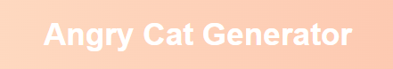
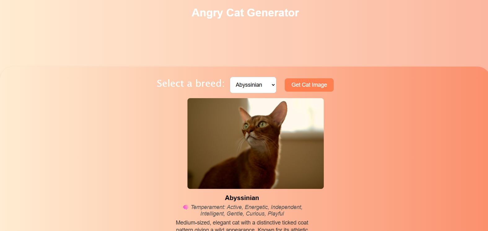
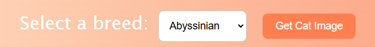
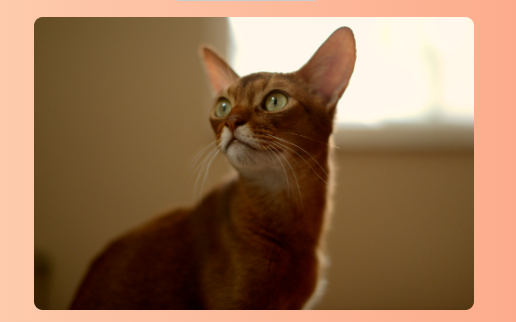
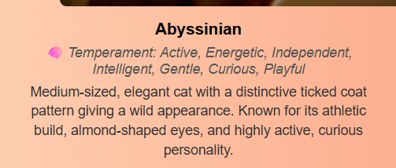

# Angry Cat

Cats are sometimes angry So i made my Angry Cat Website

We use the [The Cat API](https://thecatapi.com/) to get random beutiful or angry cat images and displas to you

Here is full overview picture:

Their is selection button and when you select breed and click on that button you will see 

That cat picture

 and a beutiful descriptiopn if present in that API

# Features:

**This is live updating because it uses API**

**You can select which breed of cat or random also**

**You will get detailed descriptions also**

**This is a cool deesign website**

# Installing

**If you want to run locally run this script in Git: "git clone https://github.com/JazilJafar/Angry-Cat.git"**

**You can also watch it from our Demo website: [Angry Cat](https://jaziljafar.github.io/Angry-Cat/)**

# LICENSE

MIT License

Copyright (c) 2026 Jazil Jafar V V

Permission is hereby granted, free of charge, to any person obtaining a copy
of this software and associated documentation files (the "Software"), to deal
in the Software without restriction, including without limitation the rights
to use, copy, modify, merge, publish, distribute, sublicense, and/or sell
copies of the Software, and to permit persons to whom the Software is
furnished to do so, subject to the following conditions:

The above copyright notice and this permission notice shall be included in all
copies or substantial portions of the Software.

THE SOFTWARE IS PROVIDED "AS IS", WITHOUT WARRANTY OF ANY KIND, EXPRESS OR
IMPLIED, INCLUDING BUT NOT LIMITED TO THE WARRANTIES OF MERCHANTABILITY,
FITNESS FOR A PARTICULAR PURPOSE AND NONINFRINGEMENT. IN NO EVENT SHALL THE
AUTHORS OR COPYRIGHT HOLDERS BE LIABLE FOR ANY CLAIM, DAMAGES OR OTHER
LIABILITY, WHETHER IN AN ACTION OF CONTRACT, TORT OR OTHERWISE, ARISING FROM,
OUT OF OR IN CONNECTION WITH THE SOFTWARE OR THE USE OR OTHER DEALINGS IN THE
SOFTWARE.

# Thank you

Our website is opensource and free try it out and contribute to this project